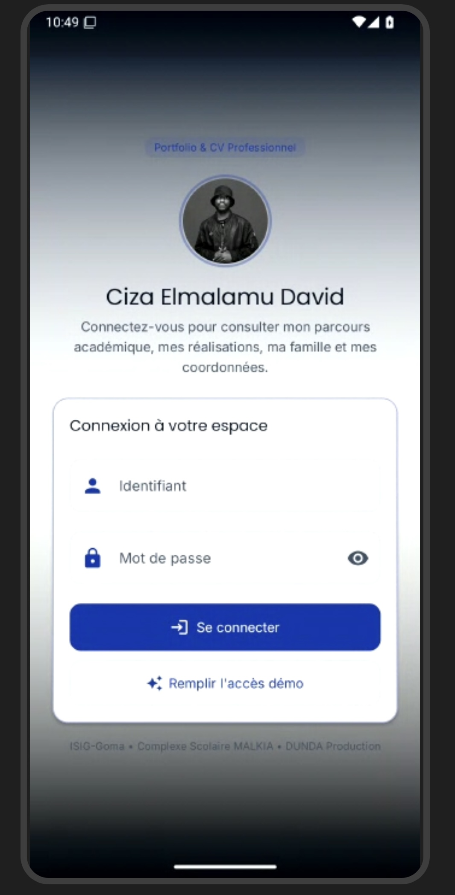
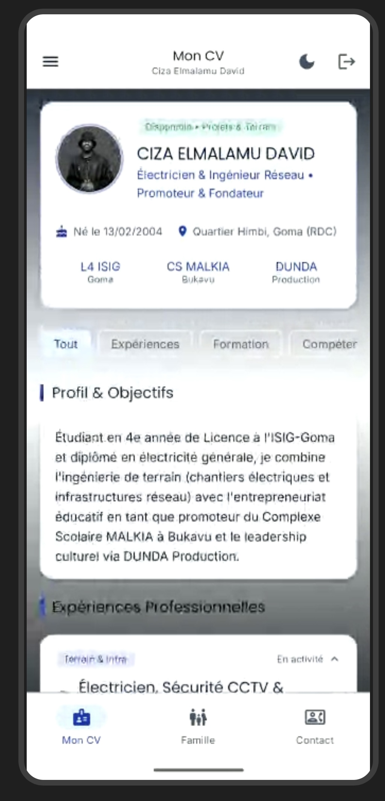
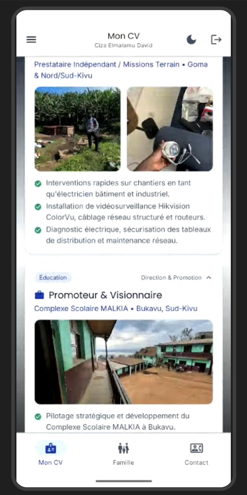
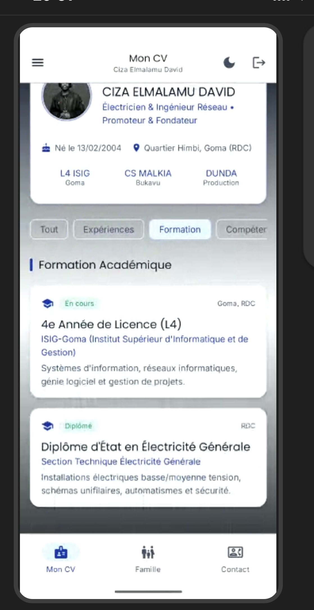
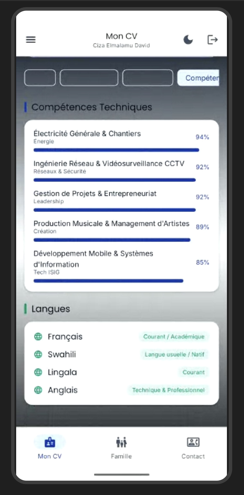
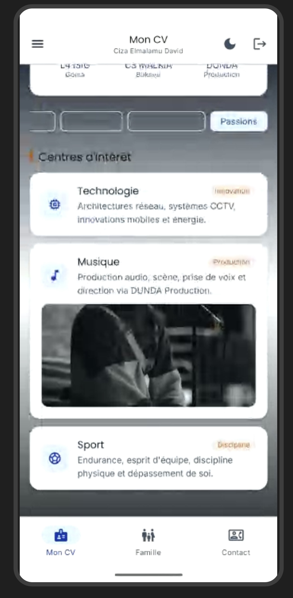
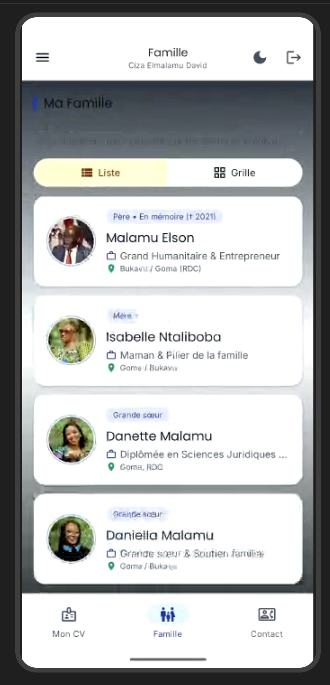
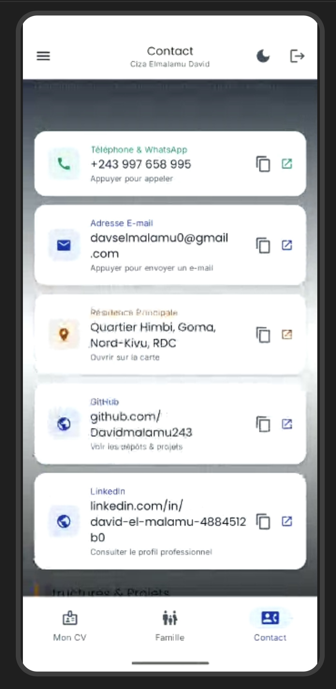

# CV Mobile — Ciza Elmalamu David

Application mobile présentant le CV complet, la famille et les coordonnées de **Ciza Elmalamu David**, avec page de connexion, navigation par `NavigationBar` et `Drawer`, cartes animées et typographie **Poppins / Inter**.

---

## Profil présenté

- **Nom complet :** Ciza Elmalamu David
- **Date de naissance :** 13/02/2004
- **Localisation :** Quartier Himbi, Goma (Nord-Kivu, RDC)
- **Formation :** Étudiant en 4e année de Licence à l'**ISIG-Goma** • Diplômé d'État en **Électricité Générale**
- **Réalisations :**
  - **Promoteur** du **Complexe Scolaire MALKIA** (Bukavu)
  - **Fondateur** de **DUNDA Production** (Production d'artistes musiciens locaux)
  - **Électricien, Sécurité CCTV & Ingénieur Réseau** (Interventions et chantiers terrain)
- **Téléphone :** +243 997 658 995
- **E-mail :** davselmalamu0@gmail.com
- **GitHub :** [github.com/Davidmalamu243](https://github.com/Davidmalamu243)
- **LinkedIn :** [linkedin.com/in/david-el-malamu-4884512b0](https://www.linkedin.com/in/david-el-malamu-4884512b0)

---

## Pages de l'application

1. **Page 1 — Connexion** : Formulaire avec champ *Identifiant*, champ *Mot de passe* masqué (avec bouton afficher/masquer), validation des champs, bouton *« Se connecter »* et bouton rapide *« Remplir l'accès démo »*.
2. **Page 2 — Accueil / Mon CV** : Photo de profil, titre, date de naissance, résidence, filtres interactifs, expériences avec photos réelles, formation, barres de compétences animées, langues et centres d'intérêt.
3. **Page 3 — Famille** : Présentation des membres de la famille (**Malamu Elson**, **Isabelle Ntaliboba**, **Danette Malamu**, **Daniella Malamu**) avec photo, lien de parenté, profession, bascule **Liste / Grille** et fiche détaillée au clic.
4. **Page 4 — Contact** : Coordonnées interactives cliquables (Appel téléphonique, E-mail, Carte Google Maps, GitHub, LinkedIn), copie rapide dans le presse-papiers et partage du profil.

---

## Captures d'écran

### 1. Connexion & Accueil CV
| Connexion | Mon CV — Profil | Mon CV — Expériences | Mon CV — Formation |
| :---: | :---: | :---: | :---: |
|  |  |  |  |

### 2. Compétences, Centres d'intérêt, Famille & Contact
| Compétences & Langues | Centres d'intérêt | Famille | Contact |
| :---: | :---: | :---: | :---: |
|  |  |  |  |

---

## Lancer le projet

1. Ouvrir le projet dans **Android Studio** (ou compiler en ligne de commande via Gradle).
2. Exécuter `gradle :app:assembleDebug` pour générer l'APK.
3. Lancer les tests unitaires et Robolectric via `gradle :app:testDebugUnitTest`.
