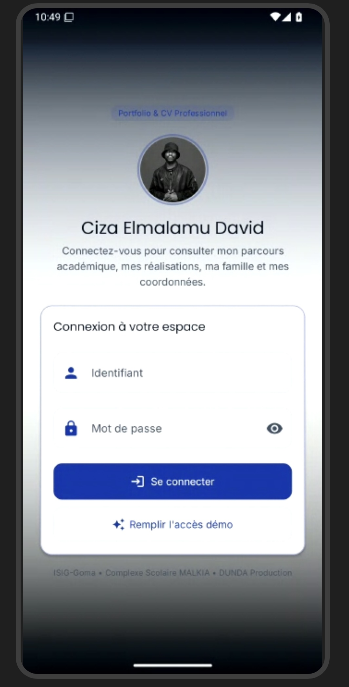
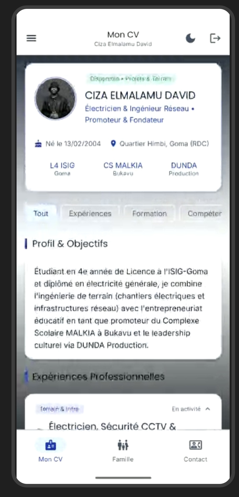
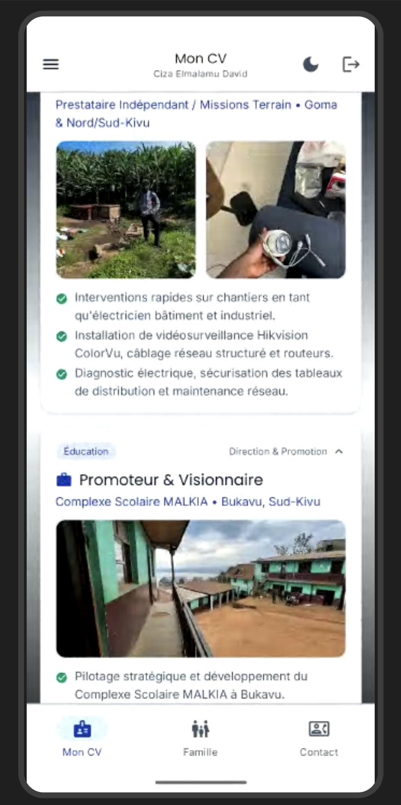
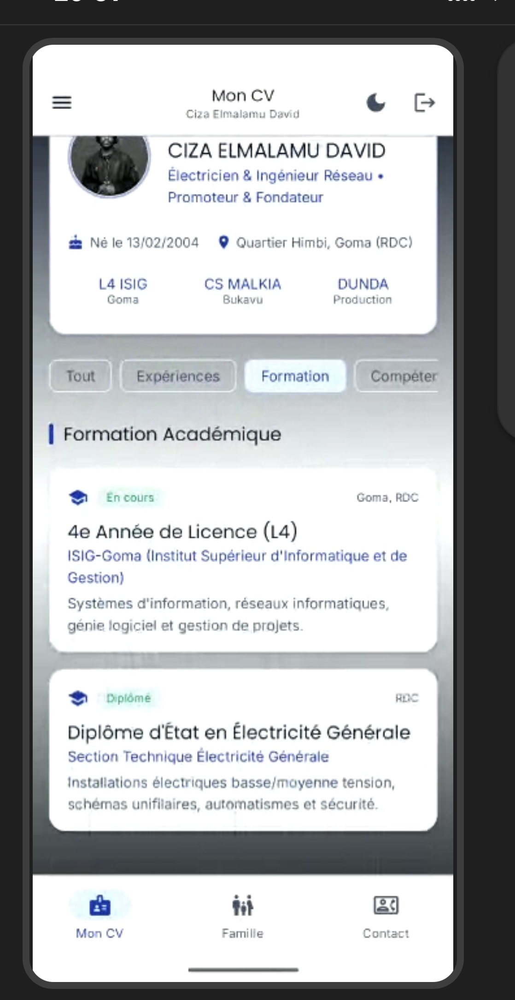
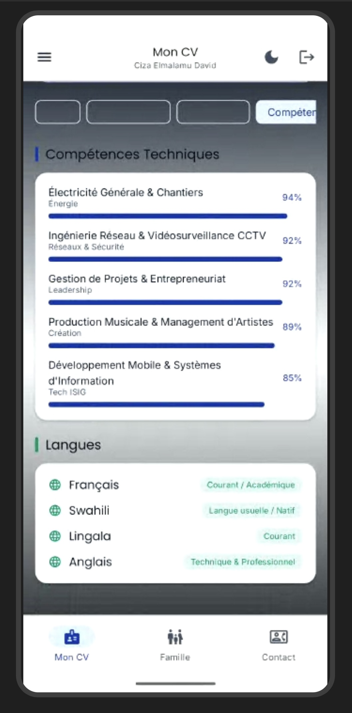
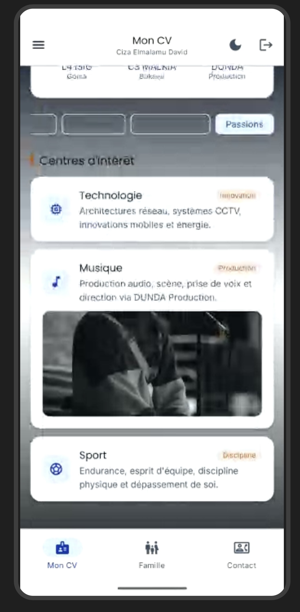
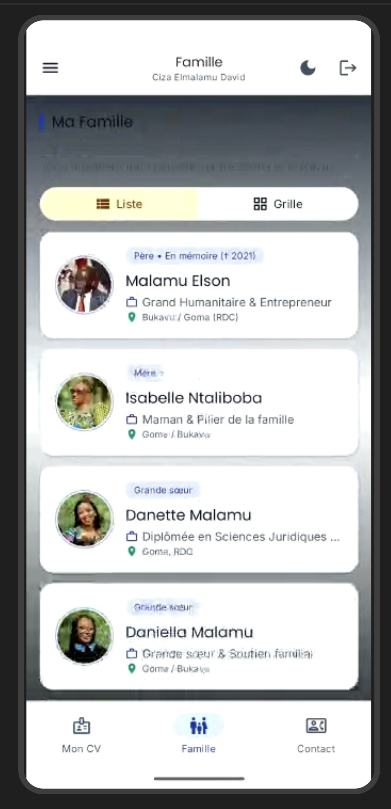
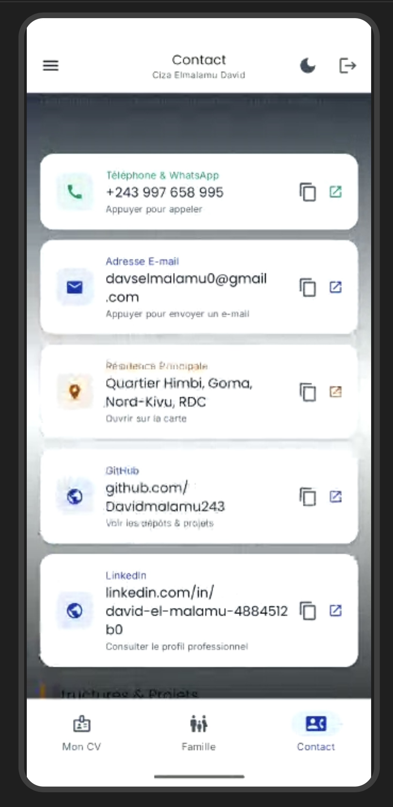

# cv_flutter_david

Application mobile Flutter présentant le CV complet, la famille et les coordonnées de **Ciza Elmalamu David**, avec page de connexion, navigation par `NavigationBar` et `Drawer`, cartes animées, polices **Poppins / Inter**, et toutes les photos réelles de ses activités et de sa famille.

## Profil présenté

- **Nom complet :** Ciza Elmalamu David
- **Date de naissance :** 13/02/2004
- **Localisation :** Quartier Himbi, Goma (Nord-Kivu, RDC)
- **Formation :** 4e année de Licence à l'**ISIG-Goma** • Diplômé en **Électricité Générale**
- **Projets & Activités :** Promoteur du **Complexe Scolaire MALKIA** (Bukavu) • Fondateur de **DUNDA Production** • Électricien, Sécurité CCTV & Ingénieur Réseau
- **Téléphone :** +243 997 658 995
- **E-mail :** davselmalamu0@gmail.com
- **GitHub :** [github.com/Davidmalamu243](https://github.com/Davidmalamu243)
- **LinkedIn :** [linkedin.com/in/david-el-malamu-4884512b0](https://www.linkedin.com/in/david-el-malamu-4884512b0)

## Captures d'écran

### Connexion & Pages du CV
| 1. Connexion | 2. Mon CV (Profil) | 3. Expériences | 4. Formation |
| :---: | :---: | :---: | :---: |
|  |  |  |  |

### Compétences, Intérêts, Famille & Contact
| 5. Compétences & Langues | 6. Centres d'intérêt | 7. Famille | 8. Contact |
| :---: | :---: | :---: | :---: |
|  |  |  |  |

## Installation & Lancement

```bash
flutter create . --project-name cv_flutter_david
flutter pub get
flutter run
```
